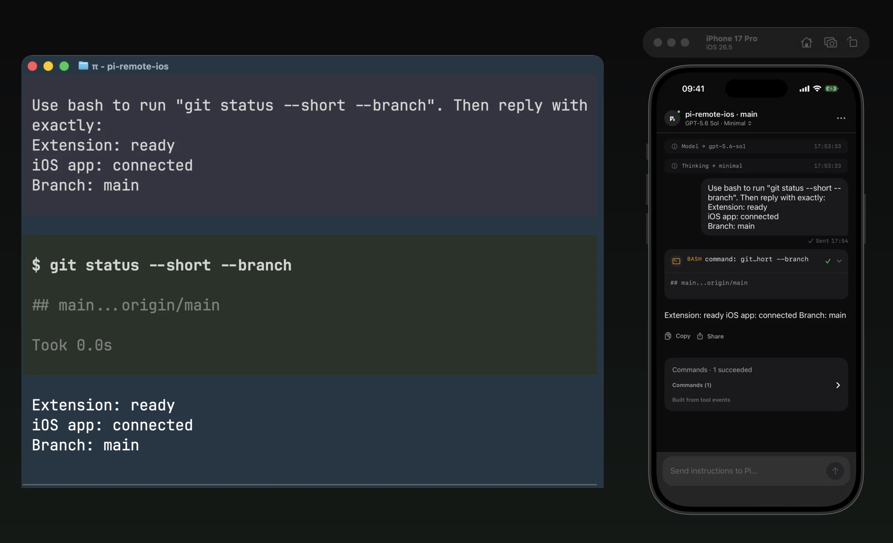

# Pi Remote for iOS

<p align="center">
  
</p>

[](https://github.com/tornikegomareli/pi-remote-ios/actions/workflows/ci.yml)
[](LICENSE)

Control an active [Pi](https://pi.dev) coding-agent session from a native iPhone app.

This repository contains both required halves:

- a TypeScript Pi extension that exposes a paired WebSocket endpoint;
- a SwiftUI iOS app that connects, authenticates, and controls the active session.

> [!WARNING]
> A paired phone can submit prompts that cause Pi to run shell commands. Treat
> remote access as terminal access to your account and current project.

Pi Remote for iOS is an independent community project. It is not affiliated
with or endorsed by Earendil Inc.

## Status

The project is an early preview. The extension works as a Pi package, while the
iOS app currently requires an Xcode build from source.

It controls the active interactive Pi session. It does not run a background Pi
daemon or manage multiple sessions.

## iOS app

<table>
  <tr>
    <td align="center" width="50%">
      
      <br><strong>Aurora Glow</strong><br>
      The screen edge and run shelf show active work.
    </td>
    <td align="center" width="50%">
      
      <br><strong>Skills</strong><br>
      Search host-side skills from the composer.
    </td>
  </tr>
  <tr>
    <td align="center" width="50%">
      
      <br><strong>Model &amp; Thinking</strong><br>
      Change the active model and thinking level.
    </td>
    <td align="center" width="50%">
      
      <br><strong>Queued follow-up</strong><br>
      Add a message without interrupting the current run.
    </td>
  </tr>
</table>

## What it can do

- Pair through a six-digit code or QR deep link.
- Store the device token in iOS Keychain.
- Reconnect with bounded backoff and keepalive checks.
- Send prompts immediately, queue follow-ups, or steer Pi's active work.
- Show sending failures inline and retry them without retyping.
- Abort and compact the active session.
- Change the active model and thinking level.
- Discover and invoke Pi skills through slash autocomplete.
- Show host, project, branch, model, and structured session status.
- Answer blocking Pi questions through first-class mobile cards.
- Show an Aurora edge glow while Pi is working.
- Stream assistant output and grouped tool execution events.
- Copy or share completed assistant responses.
- Restore current branch history and pending questions after reconnecting.
- Continue monitoring a user-started run after the app is minimized on iOS 26.
- Receive privacy-safe local alerts when Pi needs input or finishes.
- Summarize commands, failures, and changed files after Pi settles.
- Render edit and write diffs natively on iOS.
- Connect an iPhone and Pi host on the same local network.

## How it works

```text
iPhone app
    │ paired WebSocket protocol
    ▼
Pi extension inside the active terminal process
    │ Pi extension API
    ▼
Current Pi session
```

The extension validates every incoming envelope, authenticates each connection,
and sends Pi events only to authenticated clients. The protocol is versioned
and documented in [`docs/PROTOCOL.md`](docs/PROTOCOL.md).

When a user sends a prompt, the iOS app submits an iOS 26 continued-processing
task. The system provides a Live Activity while the app monitors the run in the
background. Pi Remote sends generic local notifications for needs-input and
completion events. These surfaces never contain prompts, responses, commands,
paths, or credentials.

Background monitoring is best-effort. It stops if the user removes the app from
the app switcher, the system expires the task, or the local connection cannot be
restored. Pi continues running on the host computer. This local-only path does not use APNs.

## Compatibility

| Component | Preview baseline | Validation |
|---|---|---|
| Pi | 1.5.0 | Extension, protocol, and live-prompt E2E |
| Node.js | 22.19 or newer | Ubuntu CI and Debian Bookworm E2E |
| macOS host | Current macOS | Physical iPhone acceptance |
| Linux host | Node 22 on Debian Bookworm | Docker protocol E2E; physical iPhone-to-Linux LAN testing remains open |
| Xcode | 27.1 or newer | Checked-in `Pi/Pi.xcodeproj`, Simulator, and signed device builds |
| Tuist (optional) | 4.202.6 | Only for regenerating from `Project.swift`; pinned in `.mise.toml` |
| iOS | 26.2 or newer | Current deployment target |

The iPhone and Pi host must share a local network. On Linux, allow inbound TCP traffic on port `3769`. On macOS, allow incoming connections for `node` when the firewall asks.

Pi binds its private LAN address (preferring `en0`) and skips VPN, bridge, and container interfaces. If it still picks the wrong one, pass `--host <lan-ip>`.

## Install the Pi extension

Review the extension source before installation. Pi packages run with your full user permissions.

Install the tagged preview for all projects:

```bash
pi install git:github.com/tornikegomareli/pi-remote-ios@v0.1.0-preview.1
```

For the current project only, add `-l`:

```bash
pi install -l git:github.com/tornikegomareli/pi-remote-ios@v0.1.0-preview.1
```

Try it for one Pi process without changing settings:

```bash
pi -e git:github.com/tornikegomareli/pi-remote-ios@v0.1.0-preview.1
```

For development from a local checkout:

```bash
git clone https://github.com/tornikegomareli/pi-remote-ios.git
cd pi-remote-ios
npm ci
pi -e ./extension/index.ts
```

The repository also includes `.pi/settings.json`, so running `pi` from its root
loads the local extension automatically.

## Build the iOS app

The iOS app is source-only. You need an Apple ID that Xcode can use for device signing.

Open the checked-in project. No Tuist or mise is needed:

```bash
open Pi/Pi.xcodeproj
```

A free personal team is enough. Under **Signing & Capabilities**, choose your team for the `Pi` target and, if needed, change the bundle identifier (default `com.insanearts.Pi`). Select your iPhone and press **Run**. On the first install, trust the developer under **Settings → General → VPN & Device Management**. Free-team builds expire after seven days; run again from Xcode to renew.

Aurora's shader needs the Metal toolchain: `xcodebuild -downloadComponent MetalToolchain`.

For a Simulator build:

```bash
xcodebuild -project Pi/Pi.xcodeproj \
  -scheme Pi \
  -destination 'generic/platform=iOS Simulator' \
  -skipMacroValidation \
  build
```

The Simulator does not provide the VisionKit camera scanner. Use manual pairing with `/remote start --host 127.0.0.1`.

`Project.swift` + `Tuist/` remain for optional Tuist users (`tuist generate` writes `Pi.xcworkspace` at the repo root). Keep package pins in both places in sync.

## Pair and connect

Start Pi, then run:

```text
/remote start
```

Pi binds a TLS WebSocket server (`wss://`) to the host's private LAN address and
advertises it over Bonjour (`_pi-remote._tcp`). It prints the URL with the
certificate pin (`#fp=…`), the short host fingerprint, a short-lived pairing
code, and a QR deep link.

Scan the QR code from the Pi Remote pairing screen or with the iPhone Camera
app. Or tap the Pi under **Nearby** (or paste the printed `wss://` URL), enter
the code, and tap **Connect & Pair**. Compare the fingerprint shown by the app
with the `Fingerprint:` line in Pi.

The pairing code expires after two minutes and stops working after one success.

The TLS identity and trusted devices live in `~/.pi/agent/pi-remote/` and are
shared by every Pi window, so a paired iPhone survives `/reload` and restarts.
When the Mac's IP changes, Pi rebinds and the app finds it again by fingerprint
over Bonjour.

Traffic is encrypted, and the app pins the host certificate, so a LAN peer can
neither read the session nor impersonate the Mac. A paired phone still has
terminal-equivalent control: do not use port forwarding or an Internet tunnel.

`/remote autostart on` resumes the server in every interactive Pi session for
already-paired devices; pairing a new device still needs `/remote start`.

For Simulator-only loopback access:

```text
/remote start --host 127.0.0.1
```

## Remote commands

```text
/remote status
/remote stop
/remote devices
/remote revoke <device-id-prefix>
/remote rotate
/remote autostart on|off
```

`/remote stop` closes remote access without revoking trusted devices. `/remote revoke` removes one device and disconnects it in every Pi window. `/remote rotate` revokes every device.

If the app reports an outdated extension, run `/reload` and then `/remote start`.

## Development

Install dependencies and run extension checks:

```bash
npm ci
npm run check
```

Run the iOS tests:

```bash
xcodebuild -project Pi/Pi.xcodeproj \
  -scheme Pi \
  -destination 'platform=iOS Simulator,name=iPhone 17 Pro' \
  -skipMacroValidation \
  test
```

The extension test suite covers protocol decoding, authentication, tunnel
lifecycle, event mapping, question recovery, run evidence, diff payloads, and
WebSocket integration.

Run the full iOS E2E test against a real Pi process and configured model:

```bash
scripts/run-e2e.mjs
```

If several matching Simulators exist, set `PI_E2E_SIMULATOR_ID`. Set `PI_E2E_MODEL` to use another configured model, and `PI_E2E_EXTENSIONS` (comma-separated paths) when that model's provider is registered by an extension. The run uses a throwaway `PI_REMOTE_STATE_DIR`, so it never touches your paired devices.

Run Linux extension acceptance through Docker:

```bash
scripts/verify-linux-e2e.mjs
```

Use `examples/edit-diff-playground.ts` to exercise edit and write diff rendering
from a connected phone without modifying application source.

The live-session app icon source is `Pi/Design/AppIcon-LiveSession.svg`.
Regenerate its light, dark, and tinted variants with Inkscape and ImageMagick:

```bash
brew install --cask inkscape
brew install imagemagick
scripts/export-app-icon.sh
```

## Documentation

- [`docs/PROTOCOL.md`](docs/PROTOCOL.md): WebSocket envelopes, commands, events, and error codes
- [`docs/SECURITY.md`](docs/SECURITY.md): threat model and security invariants
- [`docs/SWIFT_CLIENT_NOTES.md`](docs/SWIFT_CLIENT_NOTES.md): iOS integration behavior
- [`docs/TUIST_MIGRATION.md`](docs/TUIST_MIGRATION.md): generated-project setup and migration decisions
- [`PLAN.md`](PLAN.md): architecture and implementation status
- [`CONTRIBUTING.md`](CONTRIBUTING.md): development and contribution rules
- [`PRIVACY.md`](PRIVACY.md): local data flow, storage, permissions, and deletion
- [`SECURITY.md`](SECURITY.md): private vulnerability reporting
- [`docs/RELEASE_CHECKLIST.md`](docs/RELEASE_CHECKLIST.md): remaining publication blockers

## License and branding

Project code is available under the [MIT License](LICENSE).

The Pi logo and animation are adapted from Pi's MIT-licensed website and press
kit. Their copyright notice is preserved in
[`THIRD_PARTY_NOTICES.md`](THIRD_PARTY_NOTICES.md). The MIT license does not
grant trademark rights, and use of the Pi name or logo does not imply endorsement.
